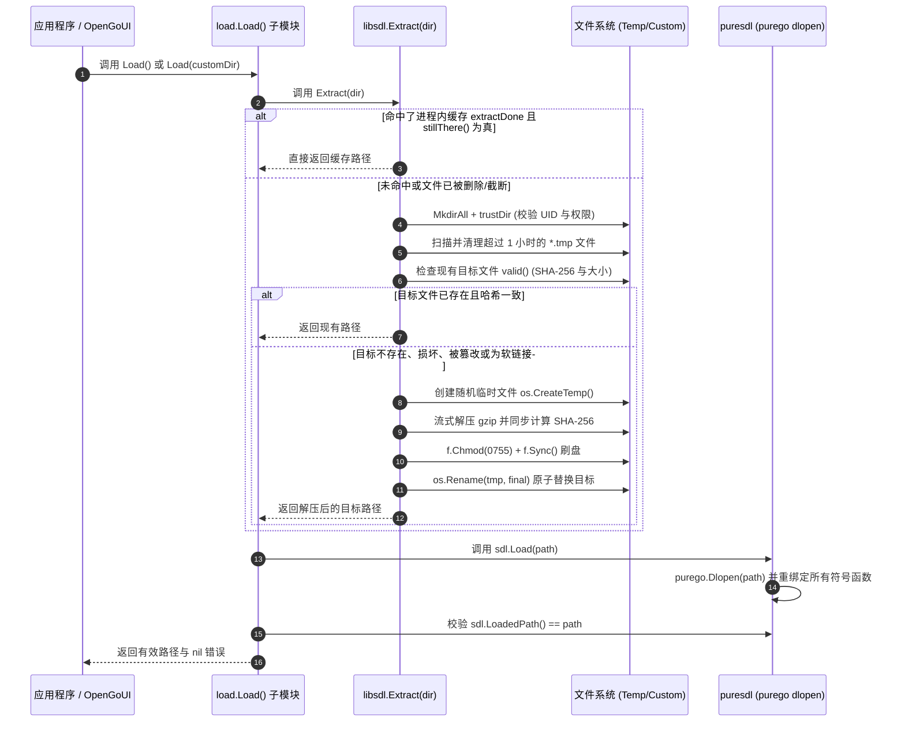

# libsdl 架构演进、优化与重构设计指南

> **文档性质**：长期维护与工程演进指导文档  
> **适用项目**：`github.com/opengoui/libsdl` 以及上游关联项目 `github.com/opengoui/puresdl`、`github.com/opengoui/opengoui`  
> **基线版本**：SDL 3.4.18（commit: `2e2f5a1`）

> **当前实施状态（2026-10-15）**：根 `go.mod` 无第三方依赖，工作区 `go.work` 已包含 OpenGoUI、puresdl、libsdl 与 `libsdl/load`；默认 load 会复用版本匹配的 SDL，Linux 权限或 noexec 失败会尝试 XDG runtime 与用户缓存目录；OpenGoUI 默认构建启用内嵌 SDL，`opengoui_noembed_sdl` 可关闭；`ExtractForce`、`IsExtracted`、`CleanCache` 与跨平台 CI 已落地。下文保留设计缘由，并标出当前实现位置。

---

## 目录

1. [项目定位与核心设计契约](#1-项目定位与核心设计契约)
2. [当前架构全景与执行流程](#2-当前架构全景与执行流程)
3. [重构与优化演进路线图](#3-重构与优化演进路线图)
   - [阶段一：工程规范与 Monorepo 开发体验对齐](#阶段一工程规范与-monorepo-开发体验对齐)
   - [阶段二：生态协同——彻底解决 macOS 双动态库冲突](#阶段二生态协同彻底解决-macos-双动态库冲突)
   - [阶段三：Linux 特殊环境（noexec/只读容器）韧性增强](#阶段三linux-特殊环境noexec只读容器韧性增强)
   - [阶段四：OpenGoUI 深度整合（零配置分发方案）](#阶段四opengoui-深度整合零配置分发方案)
   - [阶段五：API 丰富度与缓存生命周期控制](#阶段五api-丰富度与缓存生命周期控制)
   - [阶段六：构建与 CI 流水线现代化](#阶段六构建与-ci-流水线现代化)
4. [核心代码修改建议与参考实现 (Code Diffs)](#4-核心代码修改建议与参考实现-code-diffs)
5. [重构安全红线与自查清单 (Checklist)](#5-重构安全红线与自查清单-checklist)
6. [常见故障与排障手册 (Troubleshooting)](#6-常见故障与排障手册-troubleshooting)

---

## 1. 项目定位与核心设计契约

`libsdl` 的核心定位是：**为 Go 原生桌面应用（特别是 OpenGoUI 与 puresdl 生态）提供零 CGO、跨平台、免用户安装的官方 SDL3 运行时内嵌分发底座。**

在任何重构或优化过程中，必须严格坚守以下**三大架构红线与设计契约**：

1. **根模块绝对零依赖（Zero Dependencies）**：
   - 根模块 `github.com/opengoui/libsdl` **禁止引入任何第三方依赖**（包括 `purego`、`puresdl` 或第三方日志/工具库）。
   - 依赖标准库（`compress/gzip`、`crypto/sha256`、`os`、`path/filepath`、`sync`、`syscall`）。
   - 加载与绑定胶水必须保留在独立的子模块（如 `load/`）中。
2. **二进制膨胀严格受控（Single Slice Per Target）**：
   - 通过严格的 `//go:build` 条件分发，**编译目标二进制中只允许编入当前目标平台的单个压缩库**（~1.1MB）。严禁将非目标平台的资产打入可执行文件。
3. **不可动摇的文件操作安全与原子性（Atomic & Safe I/O）**：
   - 绝不就地写入正在运行的库；
   - 绝不穿透软链接写入（必须用 `Rename` 原子替换软链接本身）；
   - 临时目录必须保证同机多用户强隔离（UID 隔离与权限 0700 强制收紧）；
   - 必须通过 `f.Sync()` 与完整的 SHA-256 + 长度双重核验，拒绝半写入或篡改数据。

---

## 2. 当前架构全景与执行流程



---

## 3. 重构与优化演进路线图

### 阶段一：工程规范与 Monorepo 开发体验对齐

#### 目标
解决当前由于父目录 `go.work` 未收录 `./libsdl` 导致日常在 `libsdl` 目录内执行 `go test ./...` 报错的问题，并规范版本发布流程。

#### 具体任务
1. **工作区登记**：
   在 `/Users/tbxark/Repos/opengoui/go.work` 中追加收录：
   ```go
   use (
       ./opengoui
       ./puresdl
       ./libsdl
       ./libsdl/load
   )
   ```
2. **发布与标签契约**：
   - 根模块发布标签：`vX.Y.Z`（建议与所内嵌的 SDL 库版本形成对齐或映射，例如 `v0.3.418` 对应 SDL 3.4.18）。
   - 子模块发布标签：`load/vX.Y.Z`。
   - 移除发布分支在 `load/go.mod` 中的 `replace` 指令，使用语义化版本依赖。

---

### 阶段二：生态协同——彻底解决 macOS 双动态库冲突

**当前实现**：puresdl 提供 `SDL3_NO_AUTO_LOAD=1` 以关闭导入时自动加载；默认 `load.Load()` 会复用已经加载且版本精确匹配的系统 SDL。OpenGoUI 初始化 SDL 时先检查加载版本，不匹配时再装载内嵌版本。若应用必须在 macOS 上处理不同版本，应在进程启动前设置 `SDL3_NO_AUTO_LOAD=1`，避免 puresdl 在 `init` 阶段先加载另一份库。

#### 痛点根因分析
在 macOS 平台上，若用户已通过 Homebrew 安装了 `sdl3`（位于 `/opt/homebrew/lib/libSDL3.dylib`）：
1. 导入 `github.com/opengoui/puresdl/sdl` 时，其 `loader.go` 中的 `func init() { _ = Load("") }` 会立即执行；
2. 此时 `puresdl` 找到了 Homebrew 的库，直接 `dlopen` 加载到了当前进程；
3. 随后用户调用 `load.Load()`，`libsdl` 解压了内嵌的 `libSDL3.dylib` 并再次调用 `sdl.Load(extractedPath)`；
4. 动态链接器（dyld）再次 `dlopen` 了第二个动态库，导致 Objective-C 运行时打印类重复警告：
   `objc: Class ... is implemented in both ... and ...`，严重时可能导致窗口事件或渲染上下文串扰。

#### 优化方案设计（三级演进）

- **方案 A（联动优化 puresdl，最彻底）**：
  将 `puresdl` 的急切加载调整为**按需延迟加载（Lazy Binding）**或通过环境变量控制。
  - 在 `puresdl/sdl/loader.go` 中，将 `init()` 中的无条件加载去掉，改为在第一次调用具体 SDL API 时或显式调用 `sdl.EnsureLoaded()` 时才触发默认查找。
  - 或者支持环境变量 `SDL3_NO_AUTO_LOAD=1`，只要设置了该变量，`init()` 就不主动加载。
- **方案 B（load 模块智能探测复用）**：
  在 `load.Load(dir ...string)` 中增加检查：
  如果用户**没有**传入自定义目录（即接受默认库），且 `puresdl` 已经成功加载了系统库（`sdl.LoadedPath() != ""` 且版本号符合要求），则**不再强制解压和切换动态库**，直接返回已加载路径。
  ```go
  // 伪代码参考
  if len(dir) == 0 && os.Getenv(libsdl.DirEnv) == "" {
      if loaded := sdl.LoadedPath(); loaded != "" && sdl.LoadError() == nil {
          // 系统库已就绪且版本匹配，直接复用，规避双重 dlopen
          return loaded, nil
      }
  }
  ```
- **方案 C（OpenGoUI 平台隔离）**：
  在 OpenGoUI 架构中，macOS 默认使用 Cocoa + Metal 后端，根本无需加载 SDL。在 OpenGoUI 的构建中通过构建标签确保 macOS 构建时不触发 `libsdl`。

---

### 阶段三：Linux 特殊环境（noexec/只读容器）韧性增强

**当前实现**：`libsdl/load/load.go` 先使用 `libsdl.Extract` 的默认目录；若提取或动态加载遇到权限错误，再依次尝试 `$XDG_RUNTIME_DIR` 和 `os.UserCacheDir()`。最终错误保留初始和回退错误，包含 noexec 与 `LIBSDL_DIR` 指引。

#### 痛点分析
部分生产 Linux 环境、加固的开发机或 Docker 容器中，`/tmp` 目录常常被挂载为 `noexec`（禁止在其下执行二进制与动态库加载）。
此时 `Extract("")` 会在 `/tmp` 下正常生成文件，但之后的 `purego.Dlopen` 会直接抛出 `EACCES (Permission denied)`。

#### 优化方案
1. **多级安全目录备选策略**：
   当默认临时目录所在挂载点可能受限时，`defaultDir()` 可以支持智能回退探测：
   - 优先检测 `$XDG_RUNTIME_DIR`（标准桌面环境下通常为 `/run/user/<uid>`，性能好且支持执行）；
   - 其次检测 `$XDG_CACHE_HOME` 或 `~/.cache`；
   - 最后使用系统 `os.TempDir()`。
2. **加载失败时的智能诊断信息**：
   在 `load.Load` 或 `libsdl.Extract` 返回的错误包装中，检测是否包含 `permission denied` 或 `EACCES`。若是，在错误中输出指引：
   `"failed to load library: permission denied (check if /tmp is mounted with noexec, or set LIBSDL_DIR to a writable, executable directory)"`。

---

### 阶段四：OpenGoUI 深度整合（零配置分发方案）

**当前实现**：`opengoui/internal/platform/adapter/sdl/embedded.go` 在默认桌面构建中先检查 SDL 版本，再通过 `github.com/opengoui/libsdl/load` 复用或加载匹配的 SDL 3；失败时返回加载原因和安装提示。`noembed.go` 配合 `opengoui_noembed_sdl` 构建标签只要求系统 SDL。嵌入资产只由 SDL adapter 引入，并由 `internal/dev/archtest` 检查依赖边界。

---

### 阶段五：API 丰富度与缓存生命周期控制

当前 API 包含：
- `Extract(dir string) (string, error)`
- `Path() (string, error)`
- `Info() Library`
- `ExtractForce(dir string) (string, error)`：绕过进程缓存并验证完整哈希，必要时重写文件。
- `CleanCache() error`：清理当前用户默认缓存目录，不会卸载已映射的动态库。
- `IsExtracted(dir string) bool`：只读检查路径中的库是否匹配嵌入版本。

---

### 阶段六：构建与 CI 流水线现代化

1. **Linux 跨平台多架构本地编译体验**：
   `tools/linux/build.sh` 当前依赖 Docker 与宿主机器工具。可增加轻量检查脚本，如果宿主机器已装有 `zig` 与 `docker`，支持一键本地增量构建验证。
2. **CI 矩阵平衡**：
   恢复 PR 与 Push 阶段对核心平台编译与基本测试的覆盖：
   - Linux x86_64（Ubuntu Latest）
   - Windows x86_64（Windows Latest）
   - macOS arm64（macOS Latest）
   对 Docker 多架构模拟等重型测试保持在 `workflow_dispatch` 或定期定时流水线（Scheduled Job）中。

---

## 4. 核心代码修改建议与参考实现 (Code Diffs)

### 4.1 `load/load.go`：避免 macOS 冲突与增加 noexec 诊断

```go
// 建议的 load.Load 实现优化
func Load(dir ...string) (path string, err error) {
	if len(dir) > 1 {
		return "", errors.New("load: at most one directory may be given")
	}
	d := ""
	if len(dir) == 1 {
		d = dir[0]
	}

	// 优化点 1：若未指定自定义目录，且系统库已被 puresdl 成功加载，直接复用以避免 macOS 双库冲突
	if d == "" && os.Getenv(libsdl.DirEnv) == "" {
		if curPath := sdl.LoadedPath(); curPath != "" && sdl.LoadError() == nil {
			return curPath, nil
		}
	}

	path, err = libsdl.Extract(d)
	if err != nil {
		return "", err
	}

	if err := sdl.Load(path); err != nil {
		// 优化点 2：针对 Linux noexec 等权限问题的智能诊断
		if errors.Is(err, os.ErrPermission) || strings.Contains(err.Error(), "permission denied") {
			return "", fmt.Errorf("load: loading %s failed (permission denied; if using /tmp verify it is not mounted with noexec, or set %s): %w",
				path, libsdl.DirEnv, err)
		}
		return "", fmt.Errorf("load: loading %s: %w", path, err)
	}

	if got := sdl.LoadedPath(); got != path {
		return "", fmt.Errorf("load: %s was extracted but puresdl reports %q as the loaded library", path, got)
	}
	return path, nil
}
```

### 4.2 `extract.go`：支持智能回退临时目录候选

```go
// 备选实现：支持在 Unix 上探测更有保障的临时目录
func candidateDefaultDirs(v string, hashPrefix string) []string {
	tag := userTag()
	folder := "libsdl-" + tag + "-" + v + "-" + hashPrefix

	var dirs []string
	if runtime.GOOS != "windows" {
		// 1. 首选 XDG_RUNTIME_DIR (/run/user/UID，通常为 tmpfs 且可执行)
		if xdgRuntime := os.Getenv("XDG_RUNTIME_DIR"); xdgRuntime != "" {
			dirs = append(dirs, filepath.Join(xdgRuntime, folder))
		}
		// 2. 备选用户缓存目录 ~/.cache/libsdl
		if cache, err := os.UserCacheDir(); err == nil && cache != "" {
			dirs = append(dirs, filepath.Join(cache, "libsdl", folder))
		}
	}
	// 3. 通用兜底系统临时目录 /tmp
	dirs = append(dirs, filepath.Join(os.TempDir(), folder))
	return dirs
}
```

---

## 5. 重构安全红线与自查清单 (Checklist)

在修改 `libsdl` 或其调用方的代码时，必须对照下表逐一核实：

| 校验项 | 校验标准与要求 | 状态 |
| :--- | :--- | :---: |
| **原子写入** | 新文件先写入 `CreateTemp`，经 `f.Sync()` 后通过 `Rename` 就位。 | [x] |
| **软链接安全** | 替换目标软链接本身，不沿链接写入；有覆盖有效与失效链接的测试。 | [x] |
| **权限控制** | Unix 默认目录为 `0700`，默认缓存仅复用当前用户拥有且不被其他用户写入的文件。 | [x] |
| **并发竞态** | 进程内由互斥锁保护；跨进程使用唯一临时文件与原子替换；核心包已通过 race 测试。 | [x] |
| **哈希校验** | 流式解压同时校验长度与 SHA-256；`ExtractForce` 会绕过缓存重验。 | [x] |
| **错误透传** | 写入、同步或替换失败时移除临时文件并返回原始错误。 | [x] |
| **Windows 占用** | 替换失败时报告 DLL 可能正被进程占用，并提示关闭进程或指定其他目录。 | [x] |
| **零依赖约束** | 根模块 `go.mod` 只有模块路径和 Go 版本；加载胶水位于独立 `load` 子模块。 | [x] |

---

## 6. 常见故障与排障手册 (Troubleshooting)

### 故障 1：`pattern ./...: directory prefix . does not contain modules listed in go.work`
- **原因**：从不属于模块的目录运行了模块级 Go 命令，或在隔离构建时未启用工作区。
- **解决办法**：
  - 在模块根目录运行命令；仓库根 `go.work` 已登记 `./opengoui`、`./puresdl`、`./libsdl` 与 `./libsdl/load`。
  - 仅做发布隔离构建时才使用 `GOWORK=off`。

### 故障 2：`objc[...]: Class ... is implemented in both ... and ...` (macOS)
- **原因**：系统 Homebrew 已存在 `libSDL3.dylib`，被 `puresdl` 在 `init()` 中加载，随后 `load.Load()` 又加载了解压出来的内嵌库。
- **解决办法**：
  - 版本一致时，`load.Load()` 会直接复用当前库。
  - 若要强制使用内嵌版本，在进程启动前设置 `SDL3_NO_AUTO_LOAD=1`；版本不匹配且 puresdl 已自动加载系统库时，切换库可能仍会产生重复类提示。

### 故障 3：`libsdl: cannot replace ... is probably loaded by a running process` (Windows)
- **原因**：Windows 系统内核在 DLL 被任何进程载入时会对其施加强制文件锁，无法被重命名或写入覆盖。
- **解决办法**：
  - 关闭正在运行的占用该库的 Go 进程或调试进程；
  - 或者指定新目录：`libsdl.Extract("C:\\path\\to\\another_dir")` 或设置 `LIBSDL_DIR`。

### 故障 4：`permission denied` / `EACCES` 在 `sdl.Load(path)` 时发生 (Linux)
- **原因**：Linux 宿主环境的 `/tmp` 挂载点具有 `noexec` 安全属性，内核禁止从该分区映射可执行段。
- **解决办法**：
  - 设置 `export LIBSDL_DIR=$HOME/.cache/libsdl`（指向具有执行权限的文件系统分区）；
  - 或采用本指南【阶段三】的多级安全目录智能探测逻辑。
